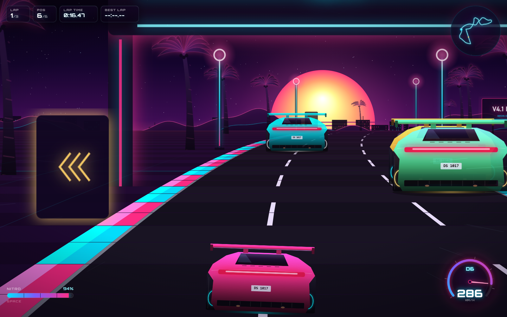
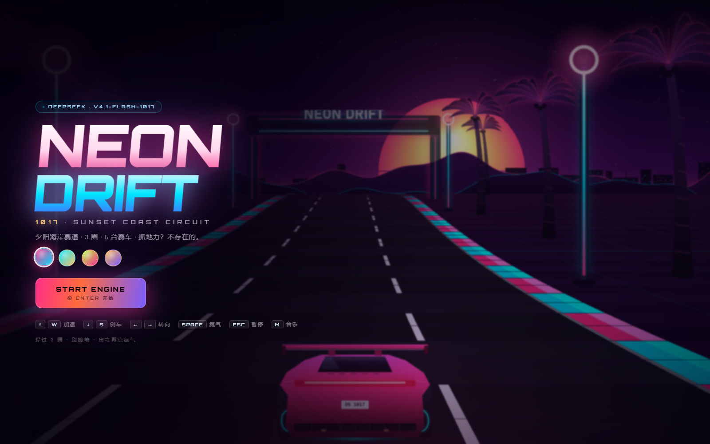
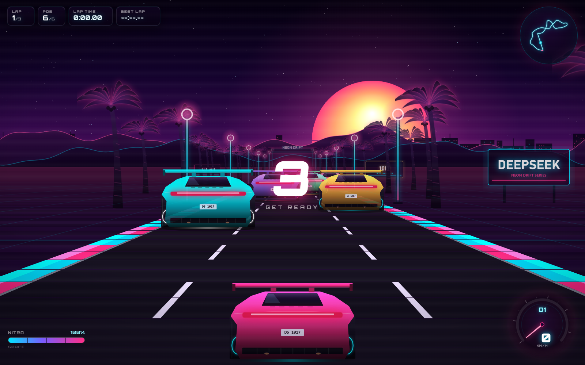
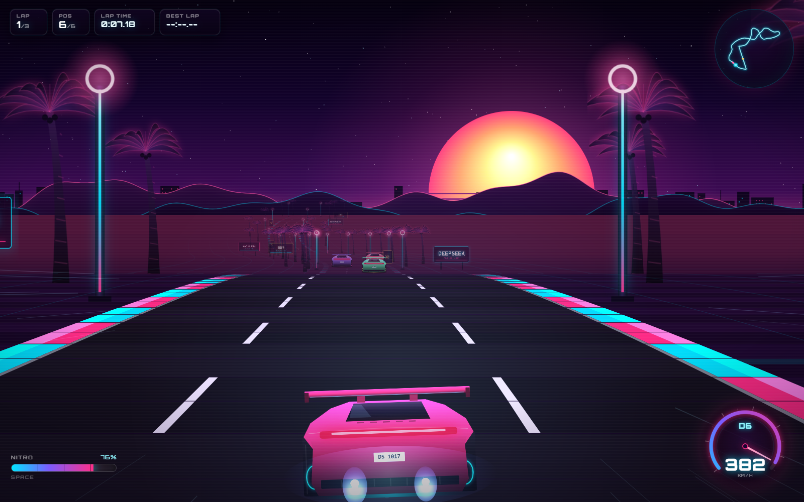
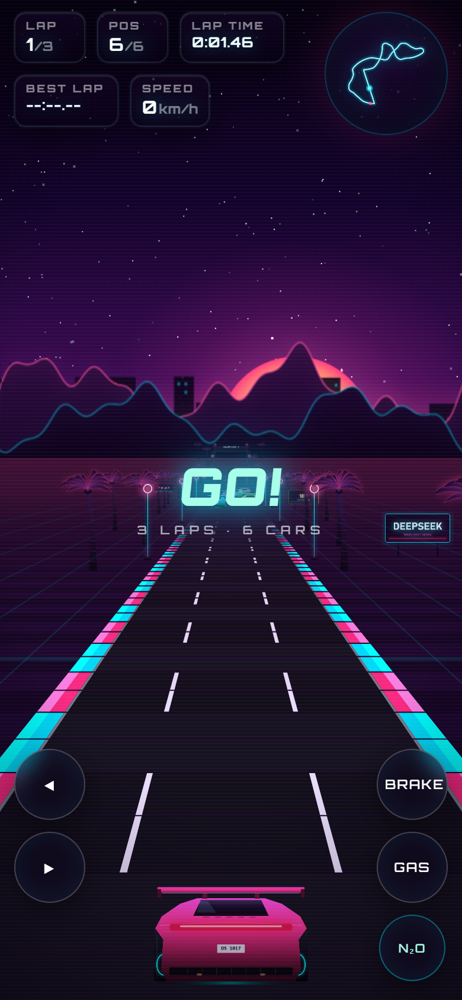

# NEON DRIFT 1017

一个**零依赖、零素材**的网页版 3D 赛车游戏。整个画面（赛道、跑车、棕榈树、广告牌、太阳、音效、音乐）全部由代码实时生成，没有任何图片、模型或第三方库。

打开 `index.html` 即可游玩（无需服务器、无需联网）。



| 主菜单 | 起跑 | 氮气 |
| --- | --- | --- |
|  |  |  |

移动端竖屏同样是完整可玩的：



## 操作

| 按键 | 作用 |
| --- | --- |
| `↑` / `W` | 加速 |
| `↓` / `S` | 刹车 |
| `←` `→` / `A` `D` | 转向 |
| `SPACE` | 氮气加速（N₂O） |
| `ESC` / `P` | 暂停 |
| `M` | 音乐开关 |
| `R` | 重新开始 |
| `F` | 显示帧率 / 渲染耗时 |

支持手柄（左摇杆转向，RT 加速、LT 刹车、A 键氮气）与移动端触屏按键。

## 玩法

* 夕阳海岸赛道，3 圈，6 台车，从最后一位（P6）起步。
* 冲出赛道会掉速并扬尘，撞上护栏会掉速打转视角。
* 氮气会消耗与自动回充，出弯再点更划算。
* 弯道里车身会向外甩，需要提前反打方向；高速大角度转向会自动进入漂移（轮胎尖叫 + 烟雾）。

## 技术要点

* **伪 3D 投影**：赛道由 3984 个路段组成，逐段做透视投影，支持连续弯道、上下坡、遮挡剔除与距离雾。
* **滚动式赛道生成**：`addRoad / addCurve / addHill / addSCurves` 组合出闭合环线，起点终点海拔自动对齐。
* **预烘焙美术**：车辆、棕榈、霓虹灯柱、广告牌、拱门全部用 Canvas 矢量绘制后缓存成贴图，运行时只做 `drawImage`。
* **纯手写车辆**：车身渐变、玻璃、尾灯、扩散器、尾翼、牌照、轮毂霓虹、氮气尾焰都是路径绘制。
* **程序化音频**：WebAudio 合成引擎声（双锯齿波 + 次谐波 + 共振低通）、风噪、胎噪、碰撞、氮气，以及一段 A 小调合成器波循环（鼓、贝斯、琶音）。
* **性能**：单帧渲染 ≈ 1ms（1440×900），包含 HUD 与小地图。

## 文件

```
index.html   结构 / HUD / 菜单 / 结算
style.css    霓虹 UI 样式与动效
game.js      渲染器、赛道、物理、AI、音频、界面逻辑
```

> 彩蛋：赛道上所有的广告牌和拱门都在给这个模型打广告。
